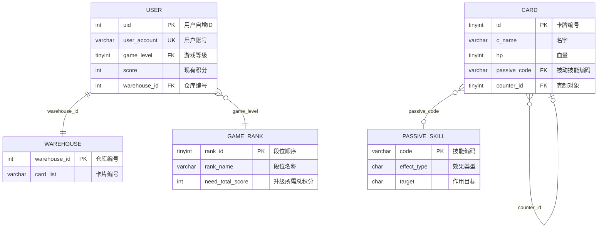

# 山海卡牌游戏 数据库设计说明

> 数据来源：`mountains_and_seas/*.sql`（MySQL 8.0.40 导出）+ `数据库表格.xlsx`  
> ER 图源文件：`docs/er-diagram.mmd`（Mermaid 语法，可直接粘进支持 Mermaid 的 Markdown / 文档工具）


---

## 一、表清单

| 表名              | 中文名     | 说明                | 数据量 |
| --------------- | ------- | ----------------- | --- |
| `user`          | 用户信息表   | 账号、段位、积分、仓库归属     | 3   |
| `warehouse`     | 仓库信息表   | 玩家持有的卡牌列表         | 3   |
| `game_rank`     | 游戏等级段位表 | 19 个段位（山稚→山海尊）    | 19  |
| `card`          | 卡牌信息汇总表 | 24 张卡牌配置          | 24  |
| `passive_skill` | 被动技能汇总表 | 10 个被动技能（P01–P10） | 10  |

---

## 二、实体关系

| 关系                       | 基数       | 实现方式                         | 说明                                             |
| ------------------------ | -------- | ---------------------------- | ---------------------------------------------- |
| `user` → `warehouse`     | 1 : 1    | **物理外键** `fk_user_warehouse` | 每个用户对应一个仓库，仓库编号随机分配                            |
| `user` → `game_rank`     | N : 1    | **逻辑关联**（仅注释声明，无 FK 约束）      | `user.game_level` → `game_rank.rank_id`        |
| `card` → `passive_skill` | N : 0..1 | **物理外键** `fk_card_passive`   | `card.passive_code` → `passive_skill.code`，可为空 |
| `card` → `card`          | N : 0..1 | **物理外键** `fk_card_counter`   | `card.counter_id` 自引用，表示克制关系                   |

### 关系图

```
                    ┌──────────────┐
                    │  game_rank   │  段位表（19 级）
                    │  rank_id  PK │
                    └──────┬───────┘
                           │ game_level (逻辑关联)
                           │ N : 1
    ┌──────────────┐      │
    │     user     │      │
    │  uid      PK │      │
    │  game_level  ├──────┘
    │  warehouse_id├──────┐
    │  score        │      │ 1 : 1
    └──────────────┘      │
                          ▼
                   ┌───────────────┐
                   │   warehouse   │
                   │ warehouse_id  │
                   │ card_list     │
                   └───────────────┘

    ┌──────────────┐         ┌──────────────────┐
    │     card     │◄────────┤  passive_skill   │
    │  id       PK │  0..1   │  code         PK │
    │  passive_code│─────────►│  effect_type     │
    │  counter_id  │         │  target          │
    └──────┬───────┘         │  effect_value    │
           │                 │  duration_round  │
           │  自引用克制      └──────────────────┘
           └──────────► card
```

---

## 三、核心表结构

### 3.1 user（用户信息表）

| 字段             | 类型          | 约束                 | 说明                          |
| -------------- | ----------- | ------------------ | --------------------------- |
| `uid`          | int         | PK, AUTO_INCREMENT | 用户自增 ID                     |
| `username`     | varchar(32) | NOT NULL           | 用户名                         |
| `user_account` | varchar(32) | NOT NULL, **UK**   | 登录账号                        |
| `user_pwd`     | varchar(64) | NOT NULL           | 密码（**生产环境应存密文**）            |
| `game_level`   | tinyint     | NOT NULL           | 游戏等级，关联 `game_rank.rank_id` |
| `score`        | int         | NOT NULL DEFAULT 0 | 现有积分                        |
| `warehouse_id` | int         | NOT NULL, FK       | 仓库编号                        |

### 3.2 warehouse（仓库信息表）

| 字段             | 类型           | 约束                 | 说明        |
| -------------- | ------------ | ------------------ | --------- |
| `warehouse_id` | int          | PK, AUTO_INCREMENT | 仓库编号，随机分配 |
| `card_list`    | varchar(255) | NULL               | 卡片编号，逗号分隔 |

> ⚠️ **设计问题**：`card_list` 用逗号分隔字符串存卡牌 ID，无法建外键、无法按卡牌查询、无法统计持有数量。若后续要做「卡牌图鉴收集进度」「按卡牌反查持有者」这类功能，建议拆成独立关联表：
>
> ```sql
> CREATE TABLE user_card (
>   uid INT NOT NULL,
>   card_id TINYINT NOT NULL,
>   PRIMARY KEY (uid, card_id),
>   FOREIGN KEY (uid) REFERENCES user(uid),
>   FOREIGN KEY (card_id) REFERENCES card(id)
> );
> ```

### 3.3 game_rank（游戏等级段位表）

| 字段                 | 类型           | 约束                 | 说明           |
| ------------------ | ------------ | ------------------ | ------------ |
| `rank_id`          | tinyint      | PK, AUTO_INCREMENT | 段位顺序（1–19）   |
| `rank_name`        | varchar(16)  | NOT NULL           | 段位名称         |
| `sub_rank`         | varchar(8)   | NOT NULL           | 小段（三段/二段/一段） |
| `need_total_score` | int          | NOT NULL           | 升级到本段满所需累计积分 |
| `remark`           | varchar(100) | NULL               | 备注           |

段位阶梯：山稚 → 山精 → 山巫 → 灵狩 → 荒伯 → 山君 → 山海尊（各 3 小段，山海尊仅一段）。

### 3.4 card（卡牌信息汇总表）

| 字段                 | 类型          | 约束                 | 说明                                |
| ------------------ | ----------- | ------------------ | --------------------------------- |
| `id`               | tinyint     | PK                 | 卡牌编号 1–24                         |
| `c_name`           | varchar(16) | NOT NULL           | 名字                                |
| `c_level`          | varchar(4)  | NOT NULL           | 品级：黄 / 玄                          |
| `hp`               | tinyint     | NOT NULL           | 血量                                |
| `skill_name`       | varchar(20) | NULL               | 技能名                               |
| `damage_or_shield` | varchar(8)  | NOT NULL           | 伤害点数或护盾：`1`–`6` / `H1`–`H5` / `无` |
| `passive_code`     | varchar(4)  | NULL, FK           | 被动技能编码 → `passive_skill.code`     |
| `counter_id`       | tinyint     | NULL, FK           | 克制对象卡牌 id → `card.id`（自引用）        |
| `is_compound`      | tinyint     | NOT NULL DEFAULT 0 | 复合型判断：0 否 / 1 是                   |

> ⚠️ **设计问题**：`damage_or_shield` 用 varchar 混存「伤害数字」和「护盾标记」两种语义。解析时要先判断首字符是不是 `H`。建议拆成两列 `damage tinyint` + `shield tinyint`，或用 JSON 列。

### 3.5 passive_skill（被动技能汇总表）

| 字段               | 类型           | 约束       | 说明                           |
| ---------------- | ------------ | -------- | ---------------------------- |
| `code`           | varchar(4)   | PK       | 技能编码 P01–P10                 |
| `skill_name`     | varchar(32)  | NOT NULL | 技能名称                         |
| `effect_type`    | char(1)      | NOT NULL | 效果类型，见下表                     |
| `target`         | char(1)      | NOT NULL | 作用目标：S 己方 / E 对手             |
| `effect_value`   | int          | NOT NULL | 效果数值（百分比存整数，如 50）            |
| `duration_round` | tinyint      | NOT NULL | 持续回合：0 立即 / 1 瞬发 / 2 持续 2 回合 |
| `effect_desc`    | varchar(200) | NOT NULL | 效果文字说明                       |

**效果类型字典**（来自 Excel「被动技能字符的含义」表）：

| 字母 | 含义   | 示例    |
| -- | ---- | ----- |
| A  | 进攻增益 | 微光、聒噪 |
| D  | 防御增益 | 水障    |
| H  | 治疗   | 人鱼润愈  |
| R  | 清除   | 清心    |
| N  | 减益   | 淡息、黏滞 |
| B  | 封锁   | 疾闪    |
| C  | 复制   | 同调    |
| E  | 反弹   | 祥光    |

---

## 四、值得注意的设计点

### 4.1 user.game_level 缺少物理外键

`user.game_level` 注释里写着「关联 game_rank.rank_id」，但建表语句里**只建了索引 `fk_user_warehouse`，没有为 game_level 建 FK 约束**。这意味着：

- 段位表里删一行，用户表里可能残留悬空引用
- 插入用户时 `game_level` 写错值（比如 99）不会被数据库拦下

建议补上：

```sql
ALTER TABLE `user`
  ADD KEY `fk_user_rank` (`game_level`),
  ADD CONSTRAINT `fk_user_rank` FOREIGN KEY (`game_level`) REFERENCES `game_rank` (`rank_id`);
```

### 4.2 克制关系是自引用，24 张卡构成 3 个环 + 2 条链

`card.counter_id` 只表达「这张卡克制谁」，是**单向**关系。实际数据里**没有任何双向克制**（检测结果：0 对）。

**3 个闭合环（覆盖 16 张卡）**

| 环   | 张数 | 链路                                                       |
| --- | -- | -------------------------------------------------------- |
| 环 1 | 11 | 文文 → 茈鱼 → 狌狌 → 葱聋 → 鸾鸟 → 旄牛 → 狡 → 鹿蜀 → 精卫 → 赤鱬 → 鯈鱼 → 文文 |
| 环 2 | 2  | 鮯鮯鱼 → 水马 → 鮯鮯鱼                                           |
| 环 3 | 3  | 旋龟 → 蛫 → 山膏 → 旋龟                                         |

**2 条未闭环的链（8 张卡，最终汇入环 3）**

```
讙 → 灌灌 → 狸力 → 妴胡 → 当康 → 类 → 䖪鼠 → 孟槐 → 山膏 →(汇入环3)
```

> **注意两点：**
>
> 1. **山膏(12) 被 2 张卡克制**（蛫、孟槐），是全表唯一入度为 2 的节点。
> 2. 环结构意味着「克制链」会无限循环，若战斗计算要做连锁克制，**必须防死循环**（建议用访问标记或限制链长）。
> 3. 若后续要支持双向或多对多克制，建议把 `counter_id` 拆成独立关联表 `card_counter(card_id, counter_card_id)`。

### 4.3 复合型卡牌

`is_compound = 1` 的有 5 张：䖪鼠(11)、山膏(12)、水马(22)、蛫(23)、鸾鸟(24)。从数据看这些卡**同时拥有主动技能和被动技能**（如 䖪鼠 = 主动「撕咬」+ 被动 P04「疾闪」）。也就是说 `card` 表一条记录承载了两类效果，代码里读卡牌时需要按 `is_compound` 分支处理。

### 4.4 段位积分是累计值

`need_total_score` 存的是**累计积分**而非增量：山稚二段要 100、山稚一段要 200、山精三段要 350…… 升段判断用 `score >= need_total_score` 即可，但要注意「不掉段」的山稚三段是初始段位（下限 0）。

---

## 五、ER 图 Mermaid 源码

完整源码见 `docs/er-diagram.mmd`，核心部分：


